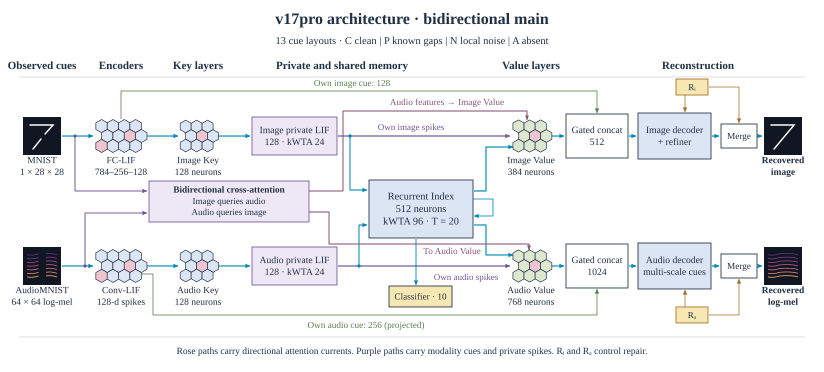

# 跨模态循环脉冲记忆 v17pro

v17pro 默认在 MNIST 和 AudioMNIST 上运行双向注意力的 `main`。图像和音频各有一组 128 单元私有 LIF，512 单元共享 Index 整合两路脉冲。两路都有观测时，交叉注意力分别给图像和音频 Value 提供对侧线索。实验沿用 13 种输入布局。



## 数据与统计

AudioMNIST 包含 **60 位说话人的 30,000 条英文数字录音**。每人对 0 到 9 各读 50 次，共 500 条。原始录音为单声道 48 kHz WAV，数据集提供说话人年龄、性别和口音等元数据。[数据集仓库](https://github.com/soerenab/AudioMNIST) · [Becker 等，AudioMNIST](https://doi.org/10.1016/j.jfranklin.2023.11.038)

| 数据 | 训练 | 验证 | 测试 |
|---|---:|---:|---:|
| MNIST 图像 | 54,001 张 | 5,999 张 | 10,000 张 |
| AudioMNIST 说话人 | 42 人 | 9 人 | 9 人 |
| AudioMNIST 原始录音 | 21,000 条 | 4,500 条 | 4,500 条 |

音频划分按说话人固定，同一人的所有录音属于同一个划分。录音重采样为 8 kHz，编码成 64×64 的 log-mel 频谱。全局归一化统计来自训练集的 2,100 条录音，类别代表从训练集中选取。用验证集选权重，训练结束后用测试集评估。

图像与音频按数字类别配对。比如任意一张手写「7」可以与同一划分中的朗读「7」组合。测试由 10,000 张图像构造观测对，可能多次抽到同一条录音。4,500 条是测试录音池的规模，每个评估条件实际覆盖的录音身份可从逐样本表检查。

## 运行

```bash
pip install -r requirements.txt
python scripts/run_v17pro_suite.py
python -u scripts/run_v17pro_suite.py --run --device cuda --audiomnist-root /path/to/AudioMNIST
```

AudioMNIST 默认位置为 `_data/AudioMNIST`，支持数据集根目录及其 `data/` 目录。首次运行计算训练集归一化并缓存 log-mel 特征。MNIST 默认位置为 `_data`，可用 `--data-root` 指定。

正式套件默认三个种子及 `main` 条件，共 12 个训练作业、510 个作业轮，输出位于 `outputs/v17pro_main_bidirectional`。使用 `--arms main main_unidirectional three_state` 可比较双向、旧单向和无注意力三组。音频局部缺失看 C/P，图像局部缺失看 P/C，两路局部缺失看 P/P。单模态条件用于检查旁路和缺席模态的类别读出。 [实现指南](docs/implementation.md) · [开发日志](docs/dev_log.md)

## 历史版本

- [v16pro 共享 Index 与区域恢复](docs/v16pro.md)
- [v15pro 污染检测与恢复](docs/v15pro.md)
- [v13pro 论文实验基线](https://github.com/xuebossvh/cross_modal_attractor_snn/blob/5983308/README.md)
